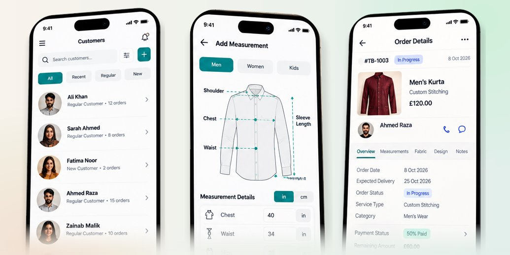

# Tailor Book: Tailoring Shop Management (Flutter)

**Order and customer management for tailoring shops: measurements, orders, delivery dates, payments and invoices, all backed up in the cloud.**

Built by [Oriental Tech Solutions](https://github.com/OrientalTechSolutions) · Flutter · Firebase

---

## Screenshots

## The need

Tailors kept measurements, orders and delivery dates in notebooks. They needed it all in one place on the phone, safely backed up.

## What we built

- **Customer list** with order history
- **Customer measurements** for men, women and kids (shoulder, chest, waist, sleeve and more)
- **Orders and delivery dates** with status: booked, measured, in progress, fitting, completed
- **Payments and invoices**, including partial payments
- **Cloud backup with Firebase**, so no data is lost if a phone is lost

## Tech stack

`Flutter` `Dart` `Firebase` `Cloud Firestore` `Authentication`

## Our role

UI implementation, app development, Firebase integration, testing and release.

---

> 🔒 **Source code is private.** This is a client project and the code belongs to the client. This repository shows the features, screens and technology used.

**Need a business or management app?** [Hire us on Upwork](https://www.upwork.com/freelancers/attaullahhazarvi)
